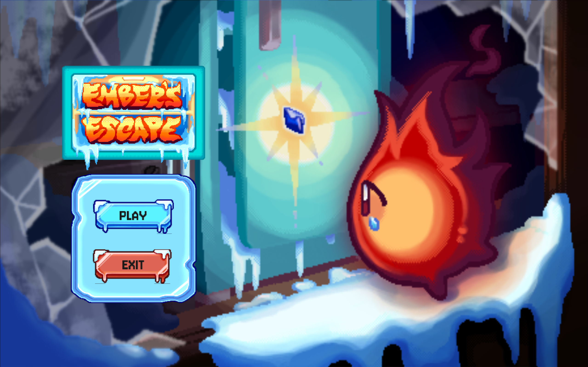
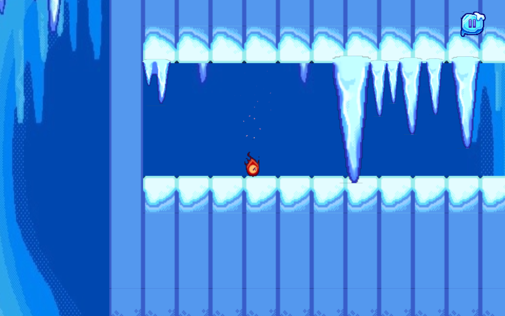
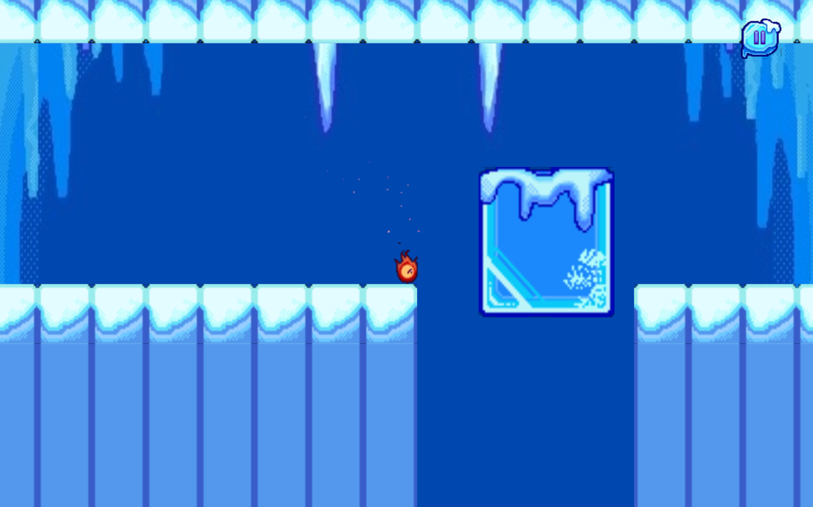

# Ember Escape
Puzzle-platformer built by a team of 5 on our own custom C++ engine (SIT–DigiPen, 2025–2026).

> Source code is in a private school repository. This page describes my contributions.

## My role
- **Physics:** force-based movement with a spatial grid so only nearby objects are collision-checked. Shipped with a 1,000-object stress test.
- **Level editor:** command-based undo/redo (20-step history), tilemap painting, property editing, JSON save/load of levels.

## Tech
C++ · custom engine · ImGui · CMake · Visual Studio

## Screenshots

